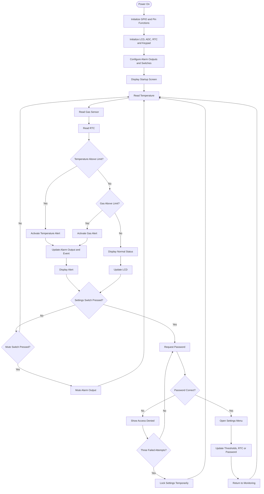

<div align="center">

# Kitchen Safety - Heat and Gas Monitoring System

### ARM7-Based Embedded Safety Monitoring

A microcontroller-based system that monitors temperature and gas levels, displays real-time readings, and activates audible and visual alerts when configured thresholds are exceeded.


</div>

---

## Table of Contents

- [Overview](#overview)
- [System Block Diagram](#system-block-diagram)
- [Features](#features)
- [Hardware Components](#hardware-components)
- [Pin Connections](#pin-connections)
- [Software Requirements](#software-requirements)
- [Project Structure](#project-structure)
- [System Flowchart](#system-flowchart)
- [How It Works](#how-it-works)
- [Default Configuration](#default-configuration)
- [Build and Flash](#build-and-flash)
- [Troubleshooting](#troubleshooting)
- [Limitations and Future Improvements](#limitations-and-future-improvements)
- [Safety Notice](#safety-notice)

---

## Overview

The Kitchen Safety Heat and Gas Monitoring System is an embedded project built around the LPC2148 ARM7 microcontroller.

The system uses an LM35 temperature sensor and an MQ-2 gas sensor to monitor environmental conditions. A 16x2 LCD displays readings, status messages, and real-time clock information.

When the measured temperature or gas sensor value exceeds its configured threshold, the system displays an alert and activates a buzzer and LED. A matrix keypad provides password-protected access to settings, allowing the user to configure thresholds, adjust the real-time clock, and change the password.

The firmware is written in Embedded C and uses separate drivers for ADC, LCD, keypad, temperature sensing, RTC, delays, and pin configuration.

## System Block Diagram

<p align="center">
  
</p>

The LPC2148 reads sensor values, evaluates the configured thresholds, updates the LCD, and controls the alarm outputs.

## Features

| Feature | Description |
|---|---|
| Temperature monitoring | Reads the LM35 sensor through the ADC. |
| Gas monitoring | Reads the analog output of the MQ-2 sensor. |
| Real-time clock | Displays time and date using the LPC2148 RTC. |
| LCD interface | Displays readings, alerts, and menu options. |
| Audible alert | Activates the buzzer when a hazard threshold is exceeded. |
| Visual alert | Activates an LED to indicate an alarm condition. |
| Alarm mute | Allows the alarm output to be muted using Switch 2. |
| Event reminder | Periodically displays the latest recorded alarm event. |
| Password protection | Requires a password to enter the settings menu. |
| Login lockout | Temporarily locks settings access after repeated incorrect passwords. |
| Editable settings | Allows the user to change sensor thresholds, RTC values, and password. |

## Hardware Components

| Component | Purpose |
|---|---|
| LPC2148 ARM7 board | Main controller |
| LM35 sensor | Temperature measurement |
| MQ-2 sensor module | Gas and smoke sensing |
| 16x2 LCD | Display interface |
| 4x4 matrix keypad | Password entry and menu navigation |
| Buzzer | Audible alarm |
| LED | Visual alarm |
| RTC peripheral | Date and time |
| Switches | Settings access and alarm mute |
| Power supply and jumper wires | Power and circuit connections |
| Serial connection | Firmware programming |

### Hardware Setup

<p align="center">
  
</p>

The image shows the assembled hardware. Verify the actual sensor connections and pin assignments against the firmware before powering the board.

## Pin Connections

The following assignments are documented for the project. Confirm all connections against the source files and the physical hardware.

| Function | LPC2148 Pin or Channel | Description |
|---|---|---|
| Buzzer | `P0.28` | Digital output |
| Alarm LED | `P0.30` | Digital output |
| Settings switch | `P0.1 / EINT0` | External interrupt input |
| Alarm mute switch | `P0.3` | Active-low input |
| MQ-2 sensor | `P0.29 / AIN2` | ADC channel 2 |
| LM35 sensor | Defined in `LM35.c` | Confirm the ADC channel in the driver |
| LCD | Board LCD connections | Display interface |
| Keypad | Board keypad connections | Matrix scanning |
| RTC | LPC2148 RTC peripheral | Time and date |

**Important:** Confirm the pin multiplexing and board wiring before connecting or powering the hardware.

## Software Requirements

| Software | Purpose |
|---|---|
| Keil uVision | Compile and build the firmware |
| LPC2148 device support | Target configuration and device headers |
| Flash Magic | Flash the generated HEX file |
| Serial port or supported USB-to-serial adapter | Connect the computer to the board |

The firmware uses the LPC2148 device header and Keil-specific syntax, including `__irq`.

## Project Structure

The following is a representative project layout. Actual folder names may vary.

```text
Kitchen-Safety-System/
|
+-- README.md
|
+-- src/
|   +-- main.c
|
+-- drivers/
    +-- ADC.c
    +-- ADC.h
    +-- ADC_defines.h
    +-- LCD.c
    +-- LCD.h
    +-- LCD_defines.h
    +-- LM35.c
    +-- LM35.h
    +-- KPM.c
    +-- KPM.h
    +-- KPM_defines.h
    +-- RTC.c
    +-- RTC.h
    +-- delay.c
    +-- delay.h
    +-- pin_connect_block.c
    +-- pin_connect_block.h
    +-- types.h
```

Make sure all required source files are added to the Keil project and their header files are available in the include paths.

## System Flowchart

The flowchart summarizes the main monitoring and password-protected settings workflow.



*Note: This diagram summarizes the documented workflow. Confirm exact execution order and alarm behavior against the source code.*

## How It Works

### 1. Sensor monitoring

The firmware reads the temperature sensor and the gas sensor through the ADC. Each reading is compared with its configured threshold.

### 2. Temperature alert

When the temperature exceeds the configured limit, the system displays a temperature warning and activates the alarm outputs according to the firmware logic.

### 3. Gas alert

When the MQ-2 sensor reading exceeds the configured gas threshold, the system displays a gas warning and activates the alarm outputs.

The gas value is an ADC reading, not a calibrated gas concentration in ppm.

### 4. LCD status

The 16x2 LCD displays sensor readings, gas status, time, date, and alert messages.

### 5. Alarm mute

Switch 2 is an active-low input. When pressed, it can mute the buzzer and LED according to the implemented firmware behavior. Sensor monitoring should continue.

### 6. Password-protected settings

Switch 1 opens the password entry workflow. The keypad is used to enter the password and navigate the settings menu.

The documented default password is `1234`. Three incorrect attempts trigger a temporary lockout lasting approximately 10 seconds.

### 7. Settings menu

The menu provides options for:

| Option | Function |
|---|---|
| RTC | Set time and date |
| SET | Configure temperature and gas thresholds |
| PASS | Change the password |
| EXIT | Return to the monitoring screen |

The documented menu timeout is approximately 30 seconds.

## Default Configuration

The following values are documented as the project's default settings.

| Setting | Default Value |
|---|---:|
| Temperature threshold | `40` degrees Celsius |
| Gas threshold | `300` on a 0-1023 ADC scale |
| Initial password | `1234` |
| Settings menu timeout | `30000 ms` |
| Failed attempts before lockout | `3` |
| Lockout duration | `10 seconds` |
| Alert display duration | `2500 ms` |
| Latest-event reminder interval | `10000 ms` |
| Latest-event display duration | `3000 ms` |

Example configuration definitions:

```c
#define TEMP_LIMIT        40
#define GAS_LIMIT         300
#define DEFAULT_PASSWORD  1234
#define MENU_WAIT_TIME    30000
#define POPUP_EVERY       10000
#define POPUP_FOR         3000
```

Check the actual macro names in `main.c` before changing the configuration. Rebuild and flash the firmware after making changes.

## Build and Flash

### Step 1: Open the project

1. Open Keil uVision.
2. Create or open the LPC2148 project.
3. Select the correct target device.
4. Include the required startup code.

### Step 2: Add the source files

1. Add `main.c` to the project.
2. Add all required driver source files.
3. Check the include paths for the corresponding header files.
4. Resolve missing function or header references.

### Step 3: Configure the target

1. Open the target options in Keil.
2. Set the crystal frequency to match the physical board. The project documentation specifies 12 MHz.
3. Enable HEX file generation in the Output settings.
4. Verify the peripheral clock configuration.

**Clock note:** The documented timer prescaler value `T0PR = 14999` assumes a 15 MHz peripheral clock for a nominal 1 ms timer tick. Verify the actual clock configuration before relying on timing values.

### Step 4: Build the firmware

Press `F7` to build the project. Resolve compiler and linker errors, then verify that the HEX file is generated.

### Step 5: Flash the microcontroller

1. Connect the board to the computer.
2. Put the board into ISP programming mode.
3. Open Flash Magic.
4. Select the correct device, serial port, baud rate, and HEX file.
5. Start programming and wait for completion.
6. Return the board to normal run mode and reset it.

Programming steps may vary by board. Follow the programming procedure for the hardware you are using.

## Troubleshooting

| Problem | Possible Solution |
|---|---|
| LCD is blank | Check the LCD wiring, power, and contrast. |
| Temperature reading is incorrect | Check LM35 wiring, ADC configuration, and conversion logic. |
| Gas alert is always active | Allow the MQ-2 module to warm up and verify its output and threshold. |
| Keypad gives incorrect input | Check the ribbon cable and key mapping in `KPM.c`. |
| RTC time is incorrect | Check RTC initialization and clock-setting logic. |
| Firmware does not flash | Verify ISP mode, serial port, baud rate, and HEX file. |
| Settings menu does not open | Check Switch 1 wiring and external interrupt configuration. |
| Buzzer does not sound | Check output wiring and the mute-switch state. |

## Limitations and Future Improvements

### Current Limitations

- The gas sensor reading is not a calibrated gas concentration.
- Sensor sampling may pause during blocking delays.
- The password is numeric.
- Threshold and password persistence depends on the implemented storage method.
- Sensor fault detection and a multi-event history are not documented as implemented features.

### Future Improvements

- [ ] Save thresholds and password settings in non-volatile memory.
- [ ] Add sensor-disconnection detection.
- [ ] Calibrate sensors and validate thresholds.
- [ ] Store multiple alarm events with timestamps.
- [ ] Improve timing to reduce monitoring interruptions.
- [ ] Add optional notification functionality.
- [ ] Add suitable fault handling and independent safety validation.

## Safety Notice

This project is intended for educational embedded-systems use. It is **not a certified life-safety device** and must not be relied upon as the only protection against fire, overheating, or gas leaks.

Use certified safety detectors, appropriate installation practices, and proper ventilation. Test sensor behavior under controlled conditions.

---

<div align="center">

**Embedded C | ARM7 | ADC | Sensors | RTC | LCD | Keypad | Interrupts**

*Monitor readings. Detect threshold violations. Alert the user.*

</div>
